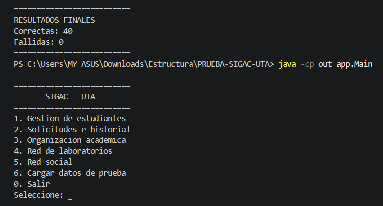
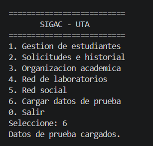
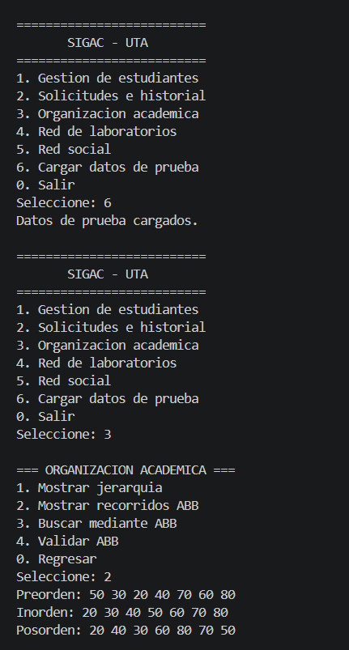
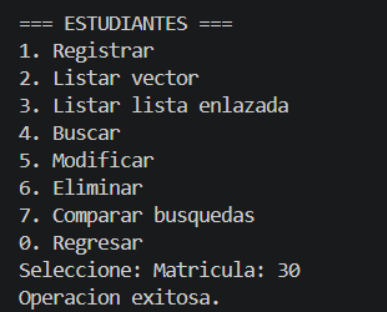
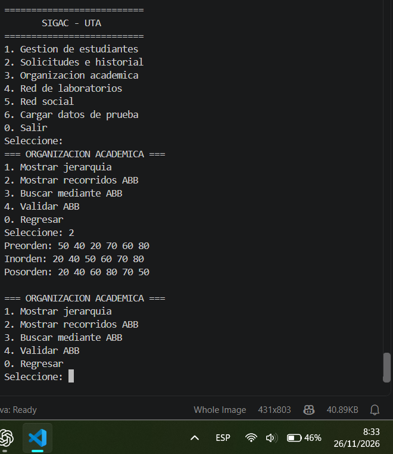
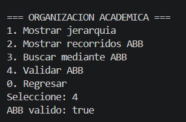

# SIGAC-UTA
## Sistema Inteligente de Gestión Académica y Conectividad

### Datos informativos

| Información | Detalle |
|---|---|
| Universidad | Universidad Técnica de Ambato |
| Facultad | Ingeniería en Sistemas, Electrónica e Industrial |
| Carrera | Ingeniería en Software |
| Nivel | Tercero B |
| Asignatura | Estructura de Datos |
| Estudiante | Shirley Micaela Yanchatipan Moreta |
| Modalidad | Individual |
| Lenguaje | Java |
| Fecha | 26 de noviembre de 2026 |

---

## 1. Introducción

El Sistema Inteligente de Gestión Académica y Conectividad (SIGAC-UTA) es una aplicación de consola desarrollada en Java que integra las principales estructuras de datos estudiadas durante el semestre.

El sistema permite gestionar estudiantes, procesar solicitudes de laboratorio, organizar la jerarquía académica, analizar la conectividad entre equipos y recomendar colaboradores mediante contactos en común.

Para su desarrollo se aprovecharon implementaciones anteriores almacenadas en GitHub, adaptándolas a los requerimientos del examen práctico integrador.

## 2. Objetivos

### Objetivo general

Desarrollar un sistema integrado de gestión académica mediante la implementación manual de estructuras de datos y algoritmos de búsqueda, recorrido y recomendación.

### Objetivos específicos

- Implementar vectores, listas enlazadas, pilas y colas para la gestión de información.
- Aplicar árboles generales, árboles binarios de búsqueda y grafos dinámicos.
- Integrar los módulos mediante un menú interactivo en Java.
- Verificar el funcionamiento mediante pruebas normales, extremas y erróneas.

## 3. Herramientas utilizadas

- Java.
- Visual Studio Code.
- Git.
- GitHub.
- ChatGPT como herramienta de asistencia técnica.

## 4. Arquitectura del proyecto

El sistema está organizado mediante paquetes que separan las entidades, estructuras, servicios, aplicación y pruebas.

| Paquete | Responsabilidad |
|---|---|
| modelo | Entidades del sistema. |
| estructuras | Estructuras de datos y algoritmos. |
| servicios | Validaciones y lógica de los módulos. |
| app | Menú principal y datos de prueba. |
| pruebas | Verificación automatizada. |
| docs | Documentación técnica. |

## 5. Desarrollo de los módulos

### M1. Gestión de estudiantes

Se implementó un vector mediante un arreglo de objetos y una lista simplemente enlazada mediante nodos.

Funcionalidades:

- Registrar estudiantes.
- Buscar por matrícula.
- Modificar información.
- Eliminar estudiantes.
- Rechazar matrículas duplicadas.
- Comparar la búsqueda secuencial con la búsqueda en el ABB.

### M2. Atención e historial

Se implementaron manualmente una cola FIFO y una pila LIFO.

La cola permite atender solicitudes de laboratorio según su orden de llegada. La pila permite almacenar las operaciones realizadas y recuperar la última solicitud atendida.

Se verifica que las solicitudes correspondan a estudiantes registrados.

### M3. Organización académica

Se implementó un árbol general con la siguiente jerarquía:

Universidad Técnica de Ambato → FISEI → Ingeniería en Software → Estudiantes.

También se implementó un árbol binario de búsqueda utilizando la matrícula como clave.

Operaciones:

- Inserción.
- Búsqueda.
- Eliminación.
- Preorden.
- Inorden.
- Posorden.
- Validación de la propiedad del ABB.

Para eliminar nodos con dos hijos se utiliza el sucesor inorden.

### M4. Red de laboratorios

Se implementó un grafo dinámico mediante listas de adyacencia enlazadas.

Funcionalidades:

- Registrar equipos.
- Crear conexiones dirigidas y ponderadas.
- Eliminar conexiones.
- Eliminar vértices y sus aristas incidentes.
- Ejecutar BFS.
- Ejecutar DFS.
- Identificar equipos no alcanzables.

### M5. Recomendaciones de contactos

Se utilizó un grafo no dirigido para representar amistades.

El algoritmo identifica candidatos de segundo grado, excluyendo al usuario consultado y sus amigos directos.

Las recomendaciones se ordenan mediante inserción, de mayor a menor cantidad de amigos en común. En caso de empate, se utiliza el orden alfabético.

### M6. Integración y pruebas

Los módulos se encuentran disponibles desde un menú principal.

El registro de estudiantes comparte referencias entre el vector, la lista enlazada, el ABB y el árbol general.

El servicio de atención consulta el registro de estudiantes para validar las solicitudes. El menú impide eliminar estudiantes que tengan solicitudes asociadas.

Las estructuras centrales fueron implementadas manualmente, sin utilizar TreeMap, TreeSet ni bibliotecas especializadas de grafos.

## 6. Resolución del caso integrador

### 6.1. Árbol binario de búsqueda

Orden de inserción:

50, 30, 70, 20, 40, 60, 80.

| Recorrido | Resultado esperado |
|---|---|
| Preorden | 50, 30, 20, 40, 70, 60, 80 |
| Inorden | 20, 30, 40, 50, 60, 70, 80 |
| Posorden | 20, 40, 30, 60, 80, 70, 50 |

Al eliminar la matrícula 30, se utiliza la matrícula 40 como sucesor inorden.

Inorden esperado después de la eliminación:

20, 40, 50, 60, 70, 80.

La prueba automatizada confirmó que la matrícula 30 fue eliminada y que el ABB conserva su propiedad de ordenamiento.

### 6.2. Atención FIFO y recuperación LIFO

| Operación | Resultado verificado |
|---|---|
| Primera atención | Solicitud 1 |
| Segunda atención | Solicitud 2 |
| Tercera atención | Solicitud 3 |
| Primera recuperación | Solicitud 3 |
| Segunda recuperación | Solicitud 2 |
| Solicitudes pendientes finales | 2 |

Las solicitudes recuperadas se insertan nuevamente al inicio de la cola.

### 6.3. Conectividad de laboratorios

| Origen | Destino | Peso |
|---|---|---:|
| PC1 | SW1 | 5 |
| SW1 | SRV1 | 3 |
| SRV1 | PC2 | 4 |
| PC1 | PC3 | 2 |

PC4 permanece aislado.

Los pesos fueron asignados como valores de ejemplo, debido a que el enunciado no establece valores específicos.

| Operación | Resultado verificado |
|---|---|
| BFS desde PC1 | PC1 SW1 PC3 SRV1 PC2 |
| DFS desde PC1 | PC1 SW1 SRV1 PC2 PC3 |
| Equipos no alcanzables | PC4 |
| Eliminar SW1 → SRV1 | Operación exitosa |
| Nueva conectividad | SRV1, PC2 y PC4 no alcanzables |

Los recorridos respetan el orden de inserción de las adyacencias.

### 6.4. Recomendaciones

La red social contiene las siguientes amistades:

- Ana y Beto.
- Ana y Carla.
- Beto y Diego.
- Carla y Diego.
- Carla y Elena.

Resultados verificados:

| Recomendación para Ana | Amigos en común |
|---|---:|
| Diego | 2 |
| Elena | 1 |

El algoritmo excluye correctamente a Ana, Beto y Carla de los resultados.

## 7. Resultados obtenidos

Se realizó la compilación y ejecución local de la aplicación y de su suite de pruebas automatizadas.

| Módulo | Pruebas correctas |
|---|---:|
| M1. Gestión de estudiantes | 9/9 |
| M2. Pilas y colas | 11/11 |
| M3. Árboles | 6/6 |
| M4. Grafos | 8/8 |
| M5. Recomendaciones | 6/6 |
| **Total** | **40/40** |

### Resumen de ejecución

- Compilación: exitosa.
- Pruebas ejecutadas: 40.
- Pruebas correctas: 40.
- Pruebas fallidas: 0.
- Porcentaje de éxito de la suite: 100 %.
- Ejecución del menú principal: exitosa.

Los resultados corresponden a la ejecución local realizada el 26 de noviembre de 2026.

La aprobación de la suite no implica una cobertura exhaustiva de todos los posibles casos del sistema.

## 8. Evidencias de ejecución

### Menú principal y pruebas

### Carga de datos

### Recorridos iniciales del ABB

### Eliminación de matrícula 30

### Recorridos después de eliminar

### Validación del ABB

---

## 9. Complejidad temporal

| Operación | Complejidad |
|---|---|
| Búsqueda secuencial | O(n) |
| Eliminación en vector | O(n) |
| Búsqueda en lista enlazada | O(n) |
| Encolar | O(1) |
| Desencolar | O(1) |
| Apilar | O(1) |
| Desapilar | O(1) |
| Búsqueda en ABB | O(h) |
| Inserción en ABB | O(h) |
| Eliminación en ABB | O(h) |
| Recorrido inorden | O(n) |
| BFS | O(V + E) |
| DFS | O(V + E) |
| Ordenamiento de recomendaciones | O(k²) |

Donde n representa la cantidad de elementos, h la altura del ABB, V la cantidad de vértices, E la cantidad de aristas y k la cantidad de candidatos.

Las complejidades corresponden a las operaciones individuales de las estructuras. Los servicios pueden realizar validaciones y búsquedas adicionales.

## 10. Reutilización de trabajos anteriores

| Módulo | Repositorio de referencia |
|---|---|
| M1 | [CRUD de estudiantes](https://github.com/shirleymikaela2/CRUD-Registro-Estudiantes) |
| M1 | [Implementación de listas](https://github.com/shirleymikaela2/Tarea-3_-Implementacion-de-listas) |
| M2 | [Gestor de impresiones](https://github.com/shirleymikaela2/T4.-Laboratorio-Gestor-de-impresiones) |
| M3 | [Catálogo de la Biblioteca FISEI](https://github.com/shirleymikaela2/Cat-logo-de-la-Biblioteca-FISEI-con-rbol-general-y-ABB-en-Java.) |
| M4 y M5 | [Grafos y sistemas de recomendación](https://github.com/shirleymikaela2/T2.6_Implementacion_de_grafos_y_sistemas_de_recomendacion_en_Java) |

Se conservaron los fundamentos de las implementaciones anteriores y se adaptaron al contexto académico del sistema SIGAC-UTA.

Los repositorios originales no fueron modificados.

## 11. Compilación y ejecución

### Compilar el proyecto desde PowerShell

    javac -encoding UTF-8 -d out (Get-ChildItem -Path src -Recurse -Filter *.java).FullName

### Ejecutar el programa

    java -cp out app.Main

### Ejecutar las pruebas automatizadas

    java -cp out pruebas.PruebasSIGAC

### Menú principal

    1. Gestion de estudiantes
    2. Solicitudes e historial
    3. Organizacion academica
    4. Red de laboratorios
    5. Red social
    6. Cargar datos de prueba
    0. Salir

La opción 6 permite cargar los datos del caso integrador. Se recomienda utilizarla al iniciar una ejecución nueva.

## 12. Documentación complementaria

- [Matriz de las 40 pruebas](docs/matriz-pruebas.md)
- [Análisis de complejidad temporal](docs/complejidad.md)
- [Registro de reutilización de código](docs/reutilizacion.md)
- [Registro de contribuciones](docs/contribuciones.md)

## 13. Contribución individual

Se realizó la preparación del repositorio, organización del proyecto, incorporación de archivos, compilación, configuración del entorno y ejecución local de las pruebas.

Se utilizó asistencia de ChatGPT para revisar los trabajos anteriores, adaptar el código, resolver errores y elaborar la documentación técnica.

## 14. Limitaciones

- Los datos se almacenan en memoria durante la ejecución.
- La interfaz funciona mediante consola.
- La red social mantiene un registro independiente del registro académico.
- El tipo de equipo se valida al registrarlo, pero no se conserva como atributo del vértice.
- La protección de estudiantes con solicitudes asociadas se aplica desde el menú principal.
- Las pruebas automatizadas no cubren todos los escenarios posibles.

## 15. Conclusiones

- Se integraron las principales estructuras de datos estudiadas durante el semestre en una aplicación Java.
- Se aplicaron algoritmos de búsqueda, recorrido, eliminación y recomendación.
- Se reutilizaron implementaciones anteriores, adaptándolas a los requerimientos del proyecto SIGAC-UTA.
- Las 40 pruebas automatizadas ejecutadas localmente finalizaron satisfactoriamente, sin errores.
- GitHub permite mantener la documentación y trazabilidad del proyecto.